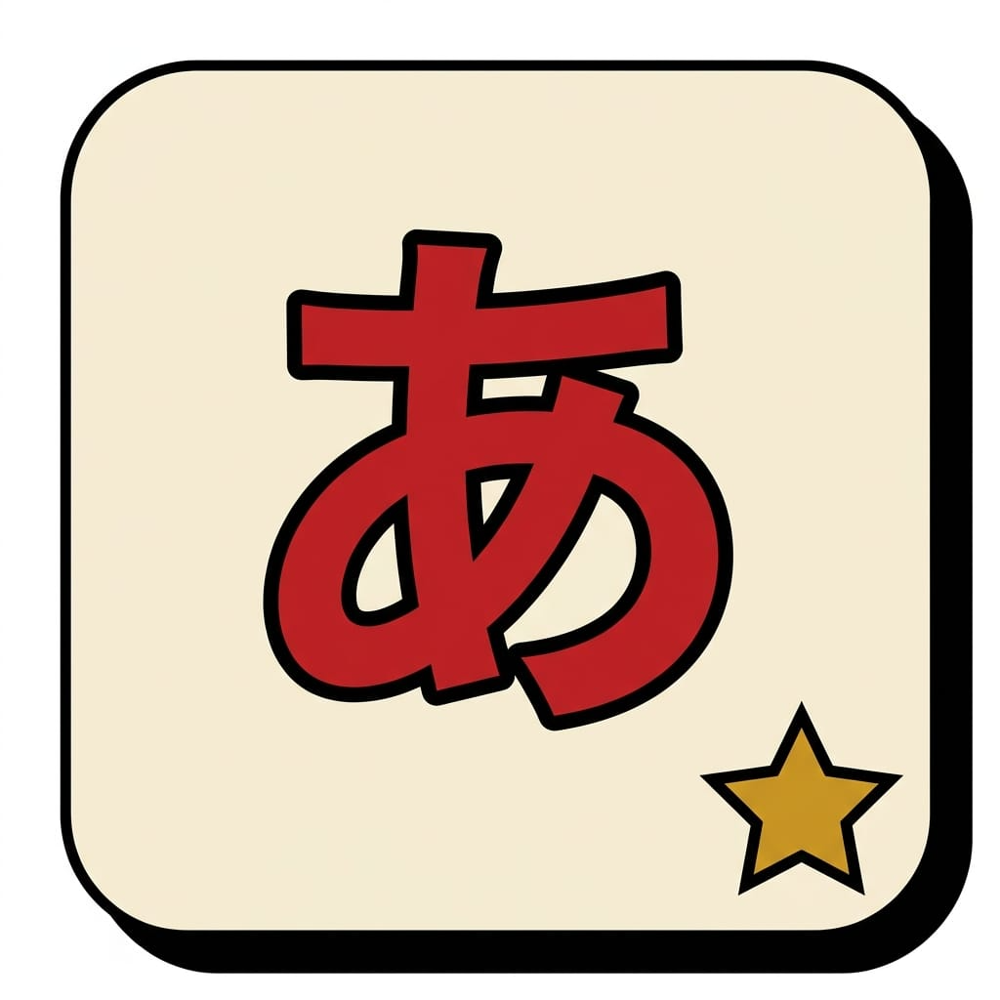

# Nihonggo

<p align="center">
  
</p>

Nihonggo adalah aplikasi iOS untuk belajar bahasa Jepang. Aplikasi ini menggabungkan materi JLPT, latihan kana, kamus, pemindaian tulisan Jepang, pelafalan audio, dan tutor AI.

## Fitur

- Materi JLPT N5 sampai N1 dengan beberapa tahap latihan dan ujian.
- Flashcard, XP, streak belajar, progres tahap, dan pembukaan level setelah nilai ujian mencapai 70%.
- Pemindaian karakter Hiragana dan Katakana dengan model Core ML di perangkat.
- OCR kalimat bahasa Jepang menggunakan Vision dengan pengenalan `ja-JP`.
- Kamus lokal yang dapat dicari, dengan data dari file JSON.
- Pelafalan teks Jepang memakai suara `ja-JP` di iOS.
- Tutor AI berbentuk chat yang dapat menjawab dalam bahasa Indonesia, Mandarin sederhana, atau Inggris.
- Antarmuka tersedia dalam bahasa Indonesia, Mandarin sederhana, dan Inggris.

Pemindaian karakter saat ini mendukung kelas Hiragana dan Katakana pada model yang disertakan. Mode kalimat membaca teks dengan OCR; hasil OCR belum otomatis diterjemahkan.

## Teknologi

- **Swift 5 dan SwiftUI** untuk aplikasi iOS; target minimum project adalah **iOS 16**.
- **Core ML dan Vision** untuk klasifikasi kana dan OCR.
- **AVFoundation** untuk akses kamera serta pelafalan melalui text-to-speech iOS.
- **Combine** untuk aliran state antarkomponen SwiftUI.
- **JSON** untuk data pelajaran, kamus, dan penyimpanan progres lokal (`Documents/userProgress.json`).
- **Node.js, Express, `node-fetch`, dan `dotenv`** untuk server proxy chat AI opsional.
- Project Xcode tidak memakai package Swift eksternal.

## Arsitektur dan design pattern

Project menggunakan **MVVM** sebagai pola utama:

- `Views/` berisi layar SwiftUI.
- `ViewModels/` mengelola state dan aksi layar.
- `Models/` mendefinisikan model data seperti `Lesson`, `FlashCard`, `ScanResult`, dan `UserProgress`.

Pola dan pendekatan lain yang dipakai:

- **Service layer** memisahkan akses kamera, inferensi ML, OCR, kamus, progres, audio, dan chat dari tampilan.
- **Observer/reactive state** memakai `ObservableObject`, `@Published`, dan Combine agar perubahan state memperbarui UI.
- **Dependency injection** melalui initializer, misalnya endpoint dan `URLSession` pada layanan AI serta provider model pada alur kamera.
- **Swift actors dan concurrency** mengisolasi kerja layanan asinkron seperti inferensi model, OCR, dan permintaan AI.
- **Resource-driven data** memuat materi dan entri kamus dari JSON di bundle aplikasi.

Folder utama:

```text
Nihonggo/
├── Nihonggo.xcodeproj/       # Project Xcode
├── Nihonggo/
│   ├── App/                  # Entry point dan shell aplikasi
│   ├── Components/           # Komponen SwiftUI yang digunakan ulang
│   ├── Models/               # Model data
│   ├── Resources/            # JSON dan model Core ML
│   ├── Services/             # Kamera, ML, OCR, AI, audio, kamus, progres
│   ├── Theme/                # Warna dan token desain
│   ├── ViewModels/           # State dan logika presentasi
│   ├── Views/                # Layar aplikasi per fitur
│   └── ai-proxy/             # Server Node.js untuk chat AI
├── Tests/                    # Sumber unit test dan UI test
└── handoff/                  # Catatan handoff ML, UI/UX, dan QA
```

## Model dan proses training

Aplikasi menyertakan `hiraganaTrain.mlmodel` dan `katakanaTrain.mlmodel` di `Nihonggo/Resources/`. Keduanya dipakai oleh layanan Core ML untuk mengenali karakter kana.

Dataset bawaan iOS digunakan sebagai dasar training. Saya juga mencari data tambahan, membersihkan data, dan memberi label sendiri sebelum melatih model. Dataset mentah dan pipeline/script training tidak disertakan di folder project ini; file model hasil training yang dipakai aplikasi tersedia di atas.

## Kolaborasi pengerjaan

Project ini dikerjakan dengan bantuan **3 agent yang bekerja sama**:

1. **Vision/ML** — integrasi model, alur kamera, klasifikasi kana, dan OCR.
2. **UI/UX** — layar, navigasi, komponen, dan sistem desain aplikasi.
3. **QA** — tinjauan alur, aksesibilitas, privasi, dan cakupan pengujian.

## Cara menjalankan aplikasi

### Persiapan

- Mac dengan Xcode yang mendukung target iOS 16.
- Simulator iOS atau iPhone untuk menjalankan aplikasi.
- Node.js dan npm hanya jika ingin menjalankan fitur tutor AI.

### Jalankan dari Xcode

1. Clone repository dan masuk ke folder aplikasi:

   ```bash
   git clone https://github.com/RETXSD/Ios.git
   cd Ios/Nihonggo
   ```

2. Buka project:

   ```bash
   open Nihonggo.xcodeproj
   ```

3. Di Xcode, pilih scheme **Nihonggo** dan simulator iOS 16 atau lebih baru, lalu tekan **Run** (`⌘R`). Untuk iPhone fisik, pilih akun Team pada pengaturan **Signing & Capabilities**.
4. Beri izin kamera saat diminta. Pemindaian kamera perlu diuji di perangkat fisik karena simulator tidak menyediakan kamera iPhone.

Build dari Terminal juga dapat dijalankan dengan mengganti nama simulator sesuai yang tersedia di Xcode:

```bash
xcodebuild -project Nihonggo.xcodeproj \
  -scheme Nihonggo \
  -destination 'platform=iOS Simulator,name=iPhone 16' \
  build
```

### Jalankan tutor AI (opsional)

Proxy AI menggunakan API key di server, bukan di aplikasi iOS. Dari Terminal kedua:

```bash
cd Ios/Nihonggo/Nihonggo/ai-proxy
npm install

export DEEPSEEK_API_KEY="isi-api-key-kamu"
export DEEPSEEK_BASE_URL="https://api.deepseek.com"
export DEEPSEEK_MODEL="deepseek-flash"
export HOST="0.0.0.0"
export PORT="3000"

npm start
```

Gunakan model yang tersedia untuk akun API kamu; daftar dan endpoint dapat berubah, jadi cek [dokumentasi resmi DeepSeek](https://api-docs.deepseek.com/). Jangan masukkan API key ke source code atau commit ke GitHub.

App saat ini mengarah ke `http://10.24.203.75:3000/chat`. Untuk memakai proxy di jaringanmu, ubah endpoint pada `Nihonggo/Services/AI/AIAssistantService.swift`:

- Simulator: gunakan `http://127.0.0.1:3000/chat`.
- iPhone fisik: gunakan `http://<IP-LAN-Mac>:3000/chat`; pastikan iPhone dan Mac berada di jaringan yang sama.

## Data dan privasi

Pemindaian karakter dijalankan di perangkat dengan model Core ML. Chat AI mengirim teks percakapan melalui proxy Node.js ke layanan API yang dikonfigurasi. Jangan mengirimkan informasi sensitif melalui chat.

## Catatan pengujian

Sumber unit test dan UI test tersedia di `Tests/`. Saat ini project Xcode hanya mendefinisikan target aplikasi `Nihonggo`, sehingga berkas test tersebut belum terhubung ke test target/scheme yang dapat dijalankan langsung dari Xcode.
